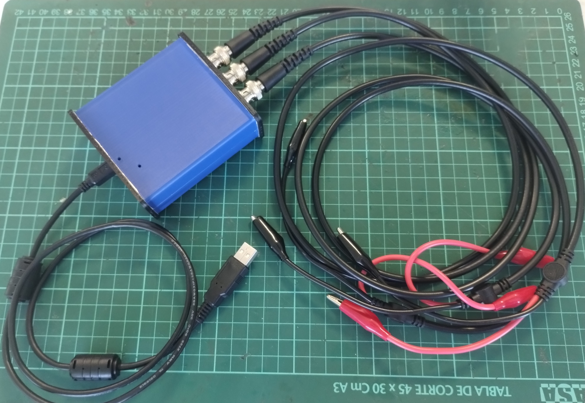
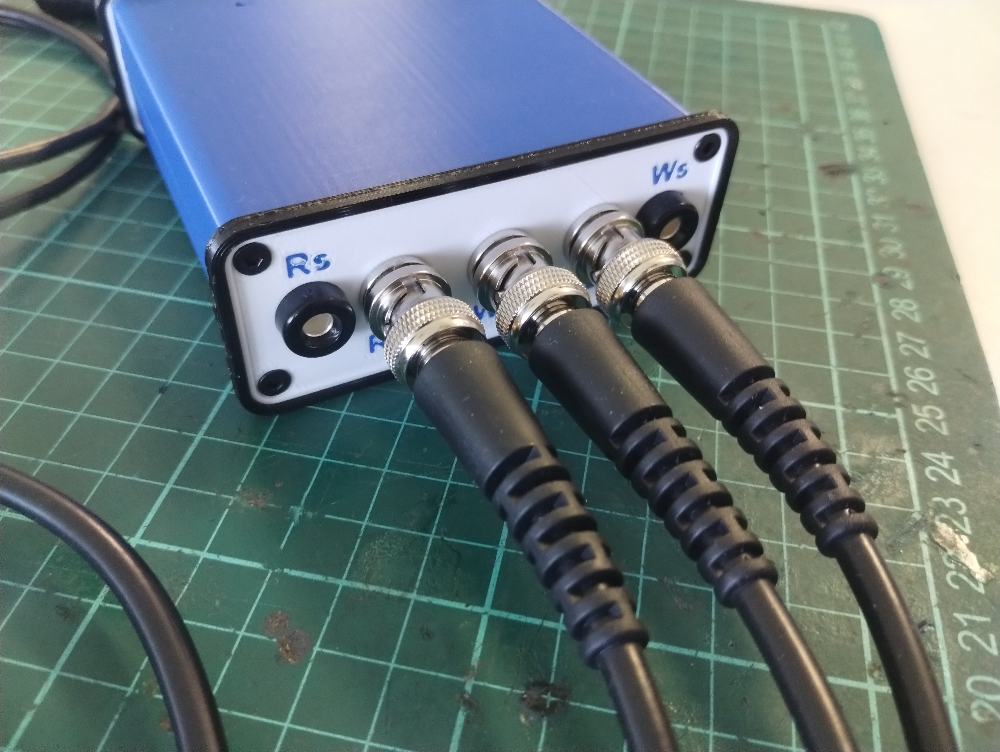

## Introducción

Parte de nuestro trabajo en el Laboratorio de Prototipado es proveer soluciones a otros laboratorios de la institución, principalmente de la Facultad de Ingeniería, aunque en ocasiones, dado la cercanía, también trabajamos con la Facultad de Agronomía.
En esta oportunidad se acercaron con la necesidad de contar con un potensiostato para realizar determinaciones inorgánicas en agua.

## Implementación

No es la primera vez que se nos acercaron al Laboratorio con este pedido. Hace unos años fabricamos un potensiostato para la Cátedra de Biosensores de la FIUNER. 



El diseño del mismo no era propio, sino que se optó por replicar un proyecto abierto, el [DStat](https://microfluidics.utoronto.ca/gitlab/dstat). En esa oportunidad fabricamos la PCB en el Laboratorio, realizamos el montaje y diseñamos un gabinete impreso para el dispositivo.



Esta vez mandamos a fabricar la placa en [JLCPCB](https://jlcpcb.com/), hicimos el montaje en el laboratorio y modificamos ligeramente el modelo 3D del gabinete.



## Modelado CAD

Hacía un tiempo habíamos incorporado una [Prusa XL](https://www.prusa3d.com/es/producto/impresora-3d-original-prusa-xl-de-un-solo-cabezal/) al Lab., impresora de gran formato pero que principalmente permite imprimir en distintos materiales al contar con extrusores independientes.



Para aprovecharla le agregamos todo un borde de TPU al frente y a la parte de atrás para que absorba los golpes y vibraciones, además de darle una mejor terminación. El resto del gabinete se imprimió en PLA y dado que estos materiales no se adhieren bien, optamos por usar el método de "interlocking" que incorpora Prusa en su Slicer.



## De Docker y Python 2 a un .exe nativo: el rediseño de DStat GUI 2.1
El programa original del DStat estaba escrito con herramientas muy viejas (Python 2.7 y GTK2) que ya nadie mantiene, así que hoy casi no se puede ejecutar. Para usarlo había que hacer un montón de pasos técnicos: instalar Docker (un programa que crea un “mini sistema” aislado para correr software antiguo), activar un componente que permite mostrar ventanas gráficas de Linux y, en Windows, conectar a mano el USB del equipo a una máquina virtual de Linux. Y después, con suerte, funcionaba.

En resumen: para medir una sola muestra había que preparar un entorno complicado y esperar que la conexión USB no fallara.

Además, la versión vieja era bastante limitada: no podía volver a abrir las mediciones guardadas ni analizar los datos. Solo guardaba los resultados en archivos de texto o de datos y sacaba capturas de los gráficos.



Con DStat GUI 2.1 eso quedó atrás. El stack se migró a Python 3.10+ y PyQt6, lo que permitió compilar un ejecutable nativo de Windows (onedir, sin Python instalado) que se abre con un doble clic. La comunicación serial es directa sobre el puerto COM, sin contenedores ni X11. Visualmente se rediseñó por completo: tema claro/oscuro con selector persistente, paleta consistente (acento teal), paneles tipo card con bordes redondeados, botones semánticos, gráfico de matplotlib estilizado con línea de acento y grilla sutil, iconos modernos en la barra de herramientas, panel de protocolo monoespaciado con colores por dirección, y mejor soporte de DPI alto. Se mantuvieron intactas la lógica de experimentos, el protocolo serie y el formato de archivos, por lo que los datos viejos siguen siendo compatibles. El resultado es una herramienta que cualquier persona puede descargar, conectar al DStat y usar en segundos, sin tocar Docker ni la línea de comandos.

## Pruebas
Para validar el potenciostato armamos una celda simulada con resistencias de 1 MΩ (Tol. 0.1%) y 4 MΩ (Tol. 1%) y con circuito abierto, aplicando 100 mV con una ganancia de transimpedancia de 3 MΩ. Cada prueba fue una cronoamperometría de 60 s, muestreada a 50 y a 60 Hz. En la primera tanda, con la placa sin limpiar y sin blindaje, la corriente medida tenía un exceso de ~17,5 nA, igual con ambas resistencias: +17,5 % con 1 MΩ y casi +70 % con 4 MΩ. Que el exceso absoluto fuera constante apuntaba a una fuga de ~5,7 MΩ en paralelo con la resistencia de prueba, y con circuito abierto el offset era de apenas ~17 pA.

Después de limpiar la PCB en ultrasonido y montarla en un gabinete con blindaje a masa, el exceso desapareció. El error quedó en −0,7 a −0,9 %, un error de escala común a ambas resistencias que es compatible con la tolerancia de los componentes. Para formar el blindaje, recubrimos las piezas impresas del gabinete con cinta de aluminio y lo conectamos a masa. Buscábamos reducir el ruido de línea, un problema que ya había aparecido en la primera versión del equipo.

 

| Prueba | Esperado | Antes: medido (error) | Antes: ruido rms | Después: medido (error) | Después: ruido rms |
|---|---|---|---|---|---|
| R = 1 MΩ, 50 Hz | 100 nA | 117,5 nA (+17,5 %) | 245 pA | 99,16 nA (−0,84 %) | 44 pA |
| R = 1 MΩ, 60 Hz | 100 nA | 117,6 nA (+17,6 %) | 3,05 nA | 99,21 nA (−0,79 %) | 1,29 nA |
| R = 4 MΩ, 50 Hz | 25 nA | 42,7 nA (+71 %) | 260 pA | 24,83 nA (−0,66 %) | 50 pA |
| R = 4 MΩ, 60 Hz | 25 nA | 42,3 nA (+69 %) | 2,38 nA | 24,76 nA (−0,94 %) | 1,87 nA |
| Abierto, 50 Hz | 0 | 0,017 nA | 54 pA | −0,13 nA | 68 pA |
| Abierto, 60 Hz | 0 | 0,016 nA | 1,95 nA | −0,10 nA | 1,65 nA |

El ruido a 50 Hz bajó de ~250 pA a ~45 pA rms, y con circuito abierto es prácticamente el mismo, así que ya estamos en el piso de la electrónica de adquisición. A 60 Hz sigue habiendo un tono de ~9,75 Hz de 1,3–1,9 nA rms: es interferencia de red eléctrica (50 Hz) aliasada al muestrear a 60 Hz, lo que la desplaza a 60 − 50 = 10 Hz. El hecho de que desaparezca al cambiar la tasa de muestreo a 50 Hz —donde la interferencia de red cae exactamente en DC y es rechazada— lo confirma.



Persiste una componente de interferencia que, por ahora, atribuimos a la red eléctrica. Sospechamos que el blindaje no tiene buena continuidad eléctrica: la cinta de aluminio podría no hacer buen contacto entre sus partes (el adhesivo puede ser aislante) o la oxidación superficial podría impedirlo. La version anterior habia sido recubierto de una capa de cobre, lograndose una diferencia mucho mas marcada en la reducción del ruido de linea.

## Efecto de la calibración en aire

Repetimos las pruebas con el proceso de calibración del dispositivo, que mide la corriente con los electrodos al aire y la resta. Comparado con las mismas mediciones sin calibrar (PCB limpia y con shield), la exactitud mejora: el error en las resistencias de prueba pasó de 0,66–0,94 % a 0,18–0,43 %, y el offset con circuito abierto bajó de unos −100 a −134 pA a ~+11 pA. Queda un error de escala de ~−0,4 % (equivalente a ~99,6 mV aplicados), que la calibración en aire no puede corregir y que es compatible con la tolerancia de las resistencias. El ruido no cambia: restar una constante no modifica la desviación estándar, y las diferencias que se ven entre corridas (por ejemplo a 60 Hz, de 1,3 a 2,0 nA con 1 MΩ) corresponden a la variación del tono de interferencia de ~9,8 Hz, no a la calibración.

| Prueba | Esperado | Sin calibrar: medido (error) | Sin calibrar: ruido rms | Calibrado: medido (error) | Calibrado: ruido rms |
|---|---|---|---|---|---|
| R = 1 MΩ, 50 Hz | 100 nA | 99,16 nA (−0,84 %) | 44 pA | 99,82 nA (−0,18 %) | 35 pA |
| R = 1 MΩ, 60 Hz | 100 nA | 99,21 nA (−0,79 %) | 1,29 nA | 99,82 nA (−0,18 %) | 2,00 nA |
| R = 4 MΩ, 50 Hz | 25 nA | 24,83 nA (−0,66 %) | 50 pA | 25,11 nA (+0,43 %) | 45 pA |
| R = 4 MΩ, 60 Hz | 25 nA | 24,76 nA (−0,94 %) | 1,87 nA | 25,10 nA (+0,42 %) | 2,36 nA |
| Abierto, 50 Hz | 0 | −0,13 nA | 68 pA | +0,011 nA | 55 pA |
| Abierto, 60 Hz | 0 | −0,10 nA | 1,65 nA | +0,012 nA | 2,04 nA |

## El equipo terminado

<figure style="margin:0;min-width:0;">

<figcaption>El potenciostato y sus cables de uso: USB y coaxiales.</figcaption>
</figure>
<figure style="margin:0;min-width:0;">

<figcaption>Detalle de los conectores BNC.</figcaption>
</figure>

## Repositorio

Todo el trabajo de software y diseño mecánico del proyecto está disponible como código abierto en [DStat-RD](https://github.com/prototipado/DStat-RD) bajo licencia GPL-3.0. El repositorio incluye:

- **GUI (Python 3 / PyQt6):** código fuente completo de DStat GUI v2.1, con instrucciones para ejecutar desde código fuente o compilar un ejecutable nativo de Windows con PyInstaller.
- **Diseño mecánico:** modelos STEP del ensamblaje y de cada pieza individual (base, tapa, panel BNC, panel USB) y mallas STL listas para impresión 3D.
- **Documentación:** manual de usuario detallado, guía de montaje paso a paso, procedimiento de calibración, conexionado de electrodos, troubleshooting y los datos crudos de la caracterización con sus scripts de análisis.

---

